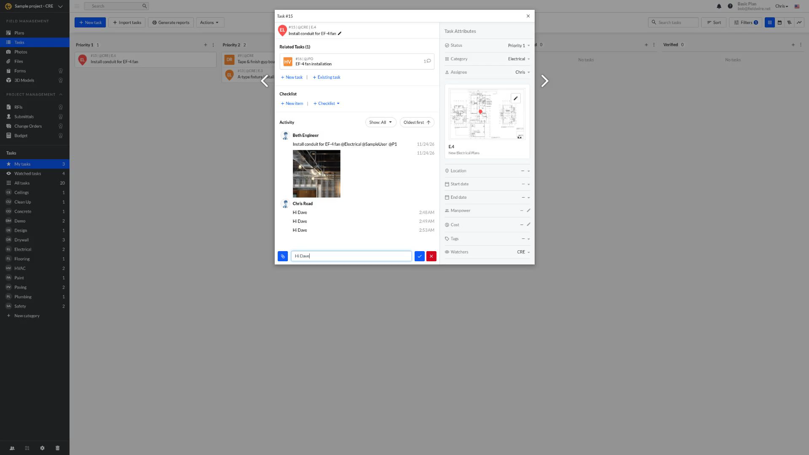

# agave — a Fieldwire connector that drives the web app

> Claude wrote this README. The stats at the bottom say what that cost.

Fieldwire (Hilti) is widely used on commercial jobs and **Agave does not integrate with
it**. Its API is the gated kind: Enterprise only, or added to a Pro/Business plan "in
conjunction with our sales team." Anyone can open a free account in two minutes.

So the integration surface is the UI. This signs in as the customer and clicks exactly
where they click. One file, top to bottom: `agave.ts`.



*The end of a real cloud run: the script found the three tasks assigned to this account,
opened one, and posted a message. `recording/` has the clip.*

## Accounts you need

| | |
| --- | --- |
| **Fieldwire** | Free plan — 3 projects, 100 sheets, 5 users, no expiry. Enough for all of this. |
| **Browserbase** | Free tier. Only needed for `npm run cloud`; `npm run local` uses your own Chromium. |
| **Claude Pro** | Only to rebuild it with Claude Code. The connector itself calls no model. |

## Run

```bash
npm install
npx playwright install chromium
cp .env.example .env     # FIELDWIRE_EMAIL / FIELDWIRE_PASSWORD

npm run local                              # headful Chromium here
npm run local -- --message "Hi Dave"       # ...and post on the first task of mine
npm run local -- --headless                # no window
npm run cloud                              # the same run on a Browserbase session
```

`--project "Sample project - CRE"` picks a project by name; otherwise the first card.

## What it does

1. Stagehand launches the browser; Playwright drives it over CDP, in the tab already open.
2. Signs in (Fieldwire gates the password behind a Continue step while it checks for SSO).
3. Clicks into the project, then the Tasks tab, then the **My tasks** filter.
4. Reads the task names the customer sees.
5. Types a message on the first one and clicks submit.

No LLM, no agent. Every step is a fixed Playwright call, so runs are reproducible and cost
nothing but browser time. Each step prints when it finished, which is what makes a
slow step obvious:

```
[0.0s] local Chromium (headless=false)
[5.1s] signed in
[5.6s] opened project 37e433b8-6942-452d-bafc-891ff1a19517
[6.8s] 3 tasks assigned to me: Install conduit for EF-4 fan | Tape & finish gyp board | ...
[7.4s] posted "Hi Dave" — POST /bubbles -> 201
```

`cloud` runs the same thing in ~11s and prints a live-debug URL while it works plus a
replay URL when it finishes — the replay is the artifact to show someone.

## The recording

`recording/74ec0fde-8fe0-4a41-b4c5-157119ffc560.mp4` is a real cloud run, start to finish.
Browserbase assembles one MP4 per tab on request:

```bash
npm run replay -- <sessionId>     # sessionId is on the "recording:" line of a cloud run
```

## Things the live site taught us

- Project pages are `app.fieldwire.com/projects/<id>/...`; only the account-level pages
  are under `/index/`.
- The DOM has stable `data-e2e` hooks — `task-name-ontaskpage`,
  `sidebar-my-tasks-filter`, `task-edit-bubble-submit-button` — so no CSS-class guessing.
- Fieldwire calls task comments **bubbles**. Enter inserts a newline, so the submit button
  has to be clicked; `POST .../bubbles -> 201` is the proof it landed.
- A free plan interrupts with coach-marks whose backdrop silently eats clicks — no error,
  just a click that does nothing. Close them by their **Close** button, and only *after*
  the board renders: they appear late, so an earlier probe dismisses nothing and every
  later click then burns its full retry budget against the backdrop.
- When a click seems to hang, look at the pixels. A headful window, Browserbase's live
  debugger, or the replay shows a covering modal instantly; the stack trace names the
  wrong element.
- The activity panel scrolls itself as images load and fights Playwright's
  scroll-into-view, so smooth scrolling is disabled before typing.

## Cost controls

Local Chromium unless you run `cloud`. Browserbase sessions are created with
`api_timeout: 300` and `keepAlive: false`, with a local watchdog as a second ceiling.

## What it took

| | |
| --- | --- |
| Time to build | 1h 2m wall, 31m of it API time, to a working `cloud` run |
| Tokens | ~17.7M, 98% served from cache — $15.06 |
| `agave.ts` | 137 lines |
| `replay.ts` | 36 lines |
| Runtime | 7.8s local, 11.2s cloud |
| Models called at runtime | none |

Most of that hour went to three things the site only tells you by being used: the real
route shape, that comments are "bubbles" behind a submit button, and that a coach-mark
lands after the board renders and silently eats clicks. The script got shorter every time
one of them was understood.
